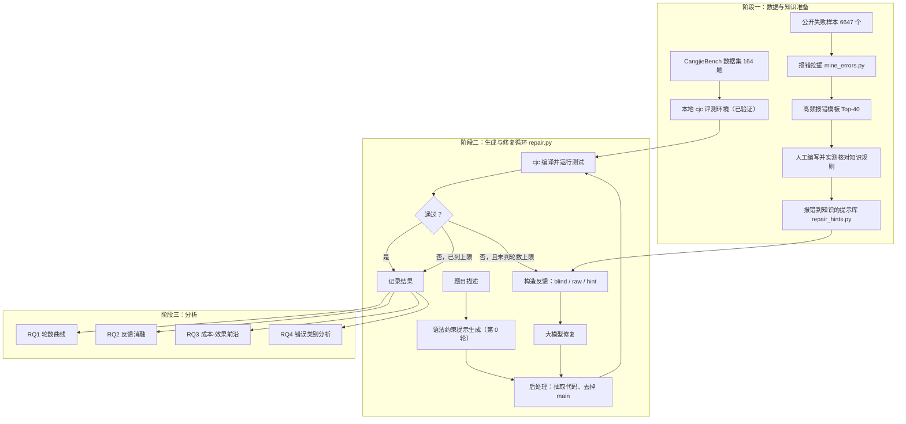
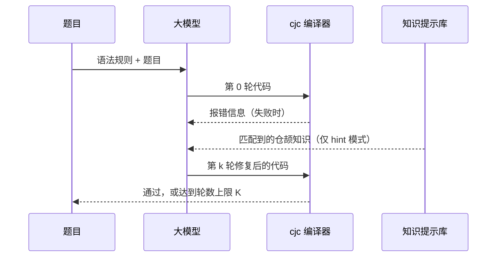
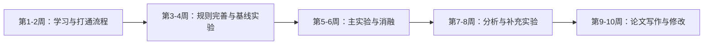

# 项目计划书

## 面向低资源编程语言仓颉的轻量级编译反馈修复方法研究

| 项目 | 内容 |
|---|---|
| 项目类型 | 本科生科研项目 / 毕业论文 / 学术论文 |
| 成员 | 同学 A（数据与知识方向）、同学 B（系统与实验方向） |
| 周期 | 约 10 周（2026 年 11 月中旬 – 2027 年 1 月下旬） |
| 经费 | 无专项经费；模型 API 费用预计 ≤ 100 元（个人承担或使用免费额度） |
| 硬件 | 个人笔记本（Windows，已装仓颉编译器 cjc 1.0.5），不需要 GPU |
| 代码仓库 | `e:\cangjie`（Git 管理） |

---

## 一、研究背景

### 1.1 仓颉语言与低资源问题
仓颉是华为面向鸿蒙全场景推出的通用编程语言，2024 年发布，2025 年开源。语言很新，公开代码很少，所以对大语言模型来说它是典型的**低资源编程语言**：模型训练时几乎没见过仓颉代码，生成时经常把 Python、Kotlin、Swift、Rust 的写法混进来，还会编造不存在的 API。

### 1.2 现有研究进展
- **CangjieBench**（arXiv:2603.14501，ESEM 2026）是第一个仓颉代码生成基准，共 248 题（HumanEval 164 + ClassEval 84）。它比较了四种方法：直接生成、语法约束提示、检索增强（RAG）、Agent。主要结论（HumanEval 文本到代码，pass@1）：

| 方法 | 代表结果 | 特点 |
|---|---|---|
| 直接生成 | 2–21% | 几乎不可用 |
| 语法约束提示（一次生成） | 41–64% | 性价比最高，但上限低 |
| RAG（文档 / 代码） | 12–47% | 不如语法约束 |
| Agent（GPT-5 + Codex CLI） | **84.8%** | 效果最好，但 token 消耗极高 |
| Agent（Kimi-K2 / Qwen3-Coder） | 25–39% | 换成便宜模型后效果大幅下降 |

- **Java→仓颉代码翻译**（arXiv，2026 年 5 月）：多阶段微调加上编译反馈修复。这项工作需要训练模型，面向的是代码翻译任务。*（标题和细节需要核实原文后再引用）*

### 1.3 研究空白
1. 在**一次生成**（便宜但上限低）和**完整 Agent**（效果好但很贵，而且依赖强模型）之间，**"轻量级多轮编译反馈修复"这一中间方案缺少系统研究**。
2. 低资源语言里，编译器报错对模型来说本身就难懂（模型不知道仓颉的正确写法）。**原始报错够不够用，要不要补充语言知识**，目前没有对照实验。
3. 已有工作缺少**成本和效果的定量权衡分析**，没法回答"在有限预算下应该怎么做"。

---

## 二、研究目标与研究问题

**总目标**：设计一种**免训练、低成本、可复现**的仓颉代码生成增强方法，并系统分析编译反馈修复在低资源语言上的效果、机理和成本。

| 编号 | 研究问题 | 对应的实验 |
|---|---|---|
| RQ1 | 多轮编译反馈修复能把语法约束基线提升多少？在第几轮饱和？ | 0–5 轮的 pass@1 曲线 |
| RQ2 | 哪种反馈最有效？原始报错和"报错 + 语言知识"相比如何？ | blind / raw / hint 三组消融 |
| RQ3 | 成本和效果怎么权衡？和 Agent 相比，效果差多少、成本省多少？ | token 和费用统计，画帕累托前沿图 |
| RQ4 | 哪些错误容易修，哪些难修？ | 按错误类别统计修复成功率 |
| RQ5（选做） | 小模型加修复循环，能不能追上不修复的大模型？ | 本地 7B 模型实验 |

---

## 三、核心创新点

> 措辞注意：论文里写"据我们所知"，投稿前要再检索一次文献。

### 创新点 1：系统研究仓颉上的轻量级编译反馈修复（填补中间方案的空白）
- 第一次在仓颉上系统研究"**不用 Agent 框架、不训练模型**"的多轮编译反馈修复，给出修复轮数和效果之间的规律。
- 回答一个实际问题：**花 Agent 几分之一的成本，能拿到 Agent 多少效果？**

### 创新点 2：数据驱动的"报错 → 语言知识"提示库（方法创新）
- 从 CangjieBench 公开的 **6647 个失败样本**中挖掘高频 cjc 报错（已完成：得到 452 种报错模板），为每类高频报错配上仓颉的正确写法，组成规则库。
- 修复时把**原始报错和匹配到的知识提示一起**交给模型，弥补模型"看得到报错，但不知道正确写法"的缺陷。
- 规则库很轻（正则加文本），零训练成本，可以迁移到其他低资源语言（如 Mojo、MoonBit）。

### 创新点 3：反馈粒度的消融实验（机理分析）
- 设置三组对照：`blind`（只说"错了"）、`raw`（原始报错）、`hint`（报错加知识提示）。用来区分三种提升来源：
  - **多试几次**本身带来的提升
  - **报错信息**带来的提升
  - **语言知识**带来的提升
- 结合错误分类，分析哪类错误靠编译器报错就能修，哪类错误必须补充语言知识。

### 创新点 4：成本和效果的定量分析，以及可复现的工具链（工程与实证贡献）
- 统计每种方案的 token 数和费用，画出"成本-效果"帕累托前沿，给出不同预算下的方法选择建议。
- 开源一套**不依赖 Docker、可在 Windows 本地运行**的评测工具，评测结果与官方完全一致（已验证 40.85% 对 40.9%）。
- 附带发现：仓颉 API 在版本之间有变化（例如 1.0 中 `ArrayList.append` 改成了 `add`），模型掌握的知识会过时。这一点可以作为讨论内容。

---

## 四、整体设计与技术路线

### 4.1 总体流程

### 4.2 修复循环的细节

### 4.3 关键模块（已实现 ✅ / 待做 ⬜）

| 模块 | 文件 | 状态 | 说明 |
|---|---|---|---|
| 编译运行与判定 | `src/runner.py` | ✅ | 判定逻辑与官方一致 |
| 数据加载 | `src/data.py` | ✅ | HumanEval 164 题 |
| 批量评测 | `src/evaluate.py` | ✅ | 并行评测，参考答案 164/164 通过 |
| 报错挖掘 | `src/mine_errors.py` | ✅ | 452 种模板 |
| 知识提示库 | `src/repair_hints.py` | 🟡 | 已有 16 条规则，需要逐条核对、扩充 |
| 生成与修复 | `src/repair.py` | 🟡 | 流程已打通，还没用真实 API 跑过 |
| 结果分析画图 | `src/analyze.py` | ⬜ | 轮数曲线、消融柱状图、成本散点图 |
| 错误自动分类 | `src/classify.py` | ⬜ | 用规则或大模型给每轮失败打错误类别标签 |

### 4.4 防止规则过拟合（方法上的严谨性）
规则从失败样本中挖出来，如果在同一批题目上评测，结果会偏高。采用两种做法：
1. **按模型划分**：只用 CangjieBench 公开的旧模型（如 ERNIE、Qwen3、GPT-5）的失败样本挖规则，在**我们新跑的模型**上评测。
2. **按题目划分**：164 题随机分成两半，一半用来挖规则，另一半用来评测，并报告两半上的结果差异。

---

## 五、实验方案

### 5.1 实验设置
| 维度 | 设置 |
|---|---|
| 数据集 | CangjieBench HumanEval 164 题（主实验）；ClassEval 84 题（选做） |
| 模型 | DeepSeek-V3.x（`deepseek-chat`）、一个 Qwen 模型（百炼或硅基流动）、GLM-4-Flash（免费）；选做：本地 Qwen2.5-Coder-7B（Ollama） |
| 初始提示 | 语法约束（主实验）、直接生成（对照） |
| 反馈模式 | blind / raw / hint |
| 最大轮数 | 5（一次跑到 5 轮，就能得到 0–5 轮的完整曲线） |
| 温度 | 0 |
| 评价指标 | 各轮累计 pass@1、编译通过率、平均修复轮数、输入/输出 token 数、费用（元）、每道通过的题平均花多少钱 |

### 5.2 实验矩阵与预算
| 编号 | 内容 | 组数 | 预计 tokens | 预计费用 |
|---|---|---|---|---|
| E0 | 基线复现（0 轮） | 3 模型 × 2 提示 | 约 2M | < 5 元 |
| E1 | RQ1+RQ2 主实验 | 3 模型 × 3 反馈 | 约 25M | 30–60 元 |
| E2 | 规则泛化（按题目划分） | 1 模型 × 2 | 约 5M | < 10 元 |
| E3 | 小模型（选做） | 本地 | — | 0 元 |
| **合计** | | | | **约 100 元以内** |

> 费用按 DeepSeek 公开价格粗略估算，以官网实时价格为准。优先用各平台的免费额度。

### 5.3 预期结果（待实验验证的假设）
- H1：修复 2–3 轮后 pass@1 明显提高，之后逐渐饱和。
- H2：效果排序为 hint > raw > blind。外来语法类错误靠 raw 报错基本就能修好；API 臆造和字符串/字符混用这类错误更依赖 hint 提示。
- H3：便宜模型加语法约束和 hint 修复，能明显超过 CangjieBench 中便宜模型的 Agent 结果（25–39%），而成本只是 Agent 的一小部分。

---

## 六、两人分工

总原则：**A 负责"知识"，B 负责"系统"，论文一起写**。每周例会一次，代码统一用 Git 管理，各自在分支上开发，合并前互相检查。

### 同学 A：数据与知识方向
| 任务 | 产出 |
|---|---|
| 系统学习仓颉语法（官方文档和教程） | 学习笔记、常见陷阱清单 |
| **维护知识提示库**：逐条核对现有规则，用 cjc 实测示例代码，并根据新实验的报错持续扩充 | `repair_hints.py`、规则核对记录表 |
| 规则泛化实验的数据划分（按题目划分） | 划分文件、规则来源说明 |
| 错误分类：制定分类标准，可以参考 CangjieBench 的 7 类，抽样人工标注 | `classify.py`、标注数据、一致性统计 |
| RQ4 错误类别分析，挑选典型修复案例 | 分析表格、2–3 个案例 |
| 论文：背景、相关工作、方法中的知识库部分、案例分析 | 对应章节 |

### 同学 B：系统与实验方向
| 任务 | 产出 |
|---|---|
| 申请和管理 API，控制预算（记录每次实验的花费） | 费用台账 |
| **维护实验流程**：完善 `repair.py`，包括断点续跑、失败重试、并发 | 稳定的实验脚本 |
| 跑 E0–E2 全部实验，管理实验配置和结果文件 | `results/` 下的结果文件和配置记录 |
| 结果分析和画图：轮数曲线、消融柱状图、成本-效果前沿图 | `analyze.py`、论文插图 |
| RQ1–RQ3 的统计，包括显著性检验（如 McNemar 检验） | 实验结果表格 |
| 论文：实验设置、实验结果、效度威胁 | 对应章节 |

### 共同任务
- 每周例会：同步进度、看实验结果、调整计划
- 精读 CangjieBench 论文（第 1 周两人都要读）
- 论文的摘要、引言、结论两人一起写，最后交叉审阅
- 准备答辩或汇报的 PPT

---

## 七、进度安排

| 周次 | 同学 A | 同学 B | 里程碑 |
|---|---|---|---|
| 1 | 学仓颉语法，精读 CangjieBench 论文 | 申请 API，用 10 题试跑修复流程 | ✅ 流程跑通 |
| 2 | 核对现有 16 条规则，核实相关论文原文 | 断点续跑、费用统计；跑 E0 基线 | ✅ 基线和论文数字一致 |
| 3 | 按题目划分数据，用训练那一半的题目重新挖规则 | E1：第一个模型，三种反馈 | |
| 4 | 根据新的报错扩充规则（目标 25–30 条） | E1：另外两个模型 | ✅ 主实验数据齐全 |
| 5 | 制定错误分类标准，抽样标注 | `analyze.py` 画图，做显著性检验 | |
| 6 | RQ4 错误类别分析，挑选案例 | E2 规则泛化实验，RQ3 成本分析 | ✅ 全部 RQ 有结论 |
| 7 | （选做）本地小模型 E3 | （选做）ClassEval | |
| 8 | 写背景、相关工作、方法 | 写实验和结果 | ✅ 论文初稿 |
| 9 | 交叉审阅、修改 | 交叉审阅、补实验 | |
| 10 | 定稿，整理开源仓库 | 定稿，准备 PPT | ✅ 提交 |

---

## 八、预期成果
1. **学术论文一篇**：可以投国内期刊（如《计算机工程与应用》《计算机科学》）、软件工程会议的学生论坛或 workshop，或者作为毕业论文。
2. **开源工具一套**：仓颉本地评测工具、修复流程、报错到知识的提示库（发到 GitHub 或 GitCode）。
3. **数据集一份**：仓颉高频编译错误统计和修复案例集。
4. 可以用这个项目申报大创，或参加"挑战杯"、华为相关赛事。

---

## 九、风险与应对

| 风险 | 可能性 | 应对 |
|---|---|---|
| 修复提升不明显 | 低（从 CangjieBench 的 Agent 结果看，有反馈的多轮交互提升很大） | 即使提升小，"反馈粒度消融"和"成本分析"本身也是有价值的实证结论 |
| 规则过拟合，被审稿人质疑 | 中 | 第四章 4.4 节的两种划分方法；明确报告泛化差距 |
| 新模型见过 CangjieBench（数据污染） | 中 | 在效度威胁中说明；选做：自己翻译 20–30 道新题做补充验证 |
| 有人发表了类似工作 | 中 | 每两周检索一次 arXiv；突出"免训练、成本分析、消融"的差异 |
| API 费用超出预算 | 低 | 先用 `--limit` 小规模试跑；优先用免费模型；`--init` 热启动节省第 0 轮的费用 |
| 仓颉版本更新导致结果变化 | 低 | 固定使用 cjc 1.0.5，在论文里写明版本 |
| 两人进度不同步 | 中 | 每周例会；任务按"知识 / 系统"划分，相互依赖少 |

---

## 十、参考文献（需核实后规范引用）
1. Cheng J., et al. *CangjieBench: Benchmarking LLMs on a Low-Resource General-Purpose Programming Language.* ESEM 2026. arXiv:2603.14501.
2. *Boosting Automatic Java-to-Cangjie Translation with Multi-Stage LLM Training and Error Repair.* arXiv, 2026.（待核实）
3. Chen M., et al. *Evaluating Large Language Models Trained on Code* (HumanEval). arXiv:2107.03374, 2021.
4. Du X., et al. *ClassEval: A Manually-Crafted Benchmark for Evaluating LLMs on Class-level Code Generation.* arXiv:2308.01861, 2023.
5. Chen X., et al. *Teaching Large Language Models to Self-Debug.* ICLR 2024.
6. Shinn N., et al. *Reflexion: Language Agents with Verbal Reinforcement Learning.* NeurIPS 2023.
7. Cassano F., et al. *Knowledge Transfer from High-Resource to Low-Resource Programming Languages for Code LLMs* (MultiPL-T). OOPSLA 2024.
8. 仓颉编程语言官方文档：https://cangjie-lang.cn
